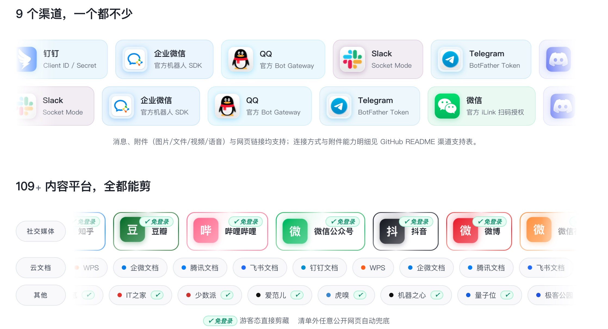
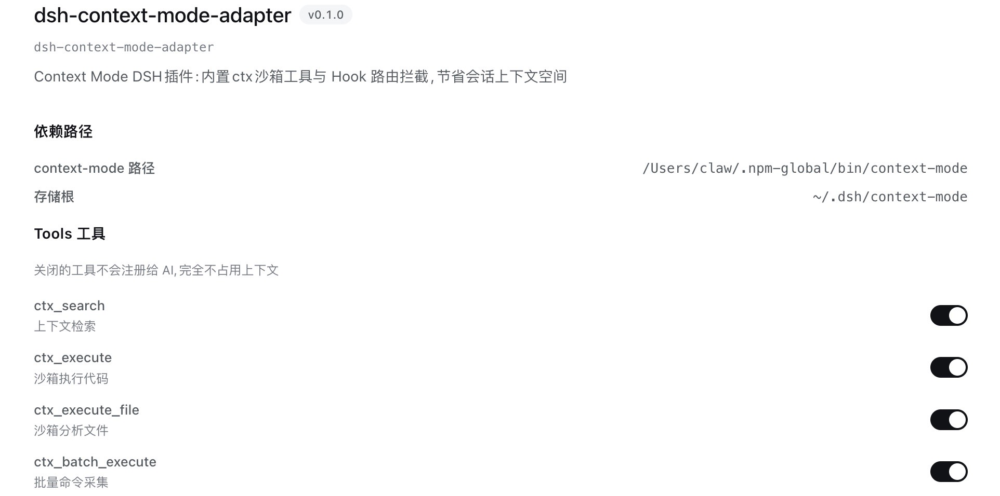

# 金鱼

  

博客：<a href="https://www.sadjjk.cn">www.sadjjk.cn</a>

<!-- STATS-START -->

<!-- STATS-END -->

  <picture>
    <source media="(prefers-color-scheme: dark)" srcset="https://raw.githubusercontent.com/sadjjk/sadjjk/output/github-snake-dark.svg" />
    <source media="(prefers-color-scheme: light)" srcset="https://raw.githubusercontent.com/sadjjk/sadjjk/output/github-snake.svg" />
    
  </picture>

---

### Go Go Go ！！！

**[obsidian-daily-jots](https://github.com/sadjjk/obsidian-daily-jots)** — 聊天即日记，链接即笔记

消息、网页与云文档剪藏进本地 Obsidian Vault，无 AI 中转 → [🌐 产品主页](https://www.sadjjk.cn/obsidian-daily-jots/)

---

**[dsh-context-mode-adapter](https://github.com/sadjjk/dsh-context-mode-adapter)** — context-mode 没有官方 DSH 插件，本仓库补上

11 个 ctx_* 工具进程内注册 + hook 路由拦截，会话上下文节省 → [Release v0.1.1](https://github.com/sadjjk/dsh-context-mode-adapter/releases/tag/v0.1.1)

---

**agent-undo 三件套** — Agent 文件变更可视化及回滚

CLI 层 [agent-undo (Fork)](https://github.com/sadjjk/agent-undo) → Hook 层 [agent-undo-hook](https://github.com/sadjjk/public-agent-skills-plugins/tree/main/plugins/agent-undo) → Skill 层 [au-viewer](https://github.com/sadjjk/public-agent-skills-plugins/tree/main/skills/au-viewer)

从命令行CLI到AgentHook自动归因 再到Skill可视化查看和回滚 三层联动

---

**[llm-batch-msg-label](https://github.com/sadjjk/llm-batch-msg-label)** — 用 LLM 对客户对话批量打标签

Markdown 定义标签 → 一条命令端到端 → Evidence 举证自动还原

---

### 我的城市

  

---

| 统计 | 语言 |
|------|------|
|  |  |
|  |  |

